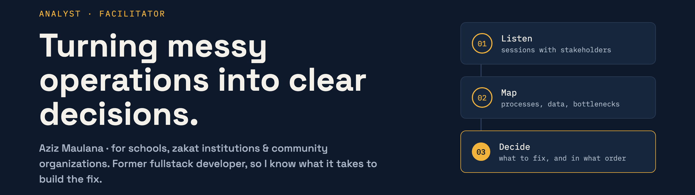
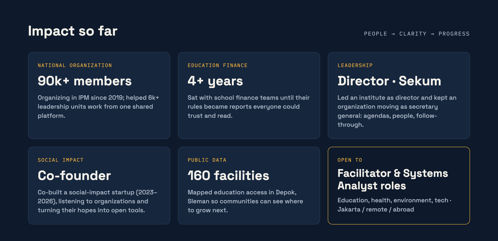
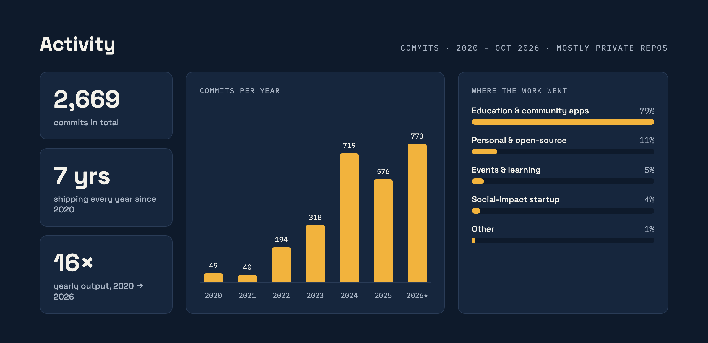

  

  

  
  
  
  

### Hi, I'm Aziz Maulana 👋

I help schools, zakat institutions, and community organizations **understand how they actually work, find where they're stuck, and agree on what to fix**.
Before this I spent 4+ years as a fullstack developer building their systems, so I know what a good requirement looks like from both sides of the table.

#### 📊 What I do

- **Process & data analysis**: map workflows, find bottlenecks, and turn messy operational data into decisions
- **Facilitation**: run discovery and requirement sessions with non-technical stakeholders (school leaders, NGO staff, community admins)
- **Bridging business ↔ tech**: translate needs into specs that developers can build

#### 🌱 Impact so far

| Area | What I did | Scale / result |
|---|---|---|
| National organization | Director, Central Data & IT Institute of PP IPM (2021–2026): turned multi-stakeholder needs into workflows for membership, finance, events, ID cards & dashboards on MY IPM | Platform with 90k+ registered members, 70k+ accounts, 6k+ leadership units |
| Education finance | Analyzed billing, discount, payment & receivable rules across many schools for a multi-school edtech platform (2022–now) and made them traceable in reports | 4+ years of production cycles, incl. institution migrations |
| Events & learning | Mapped the participant journey of an event & learning platform: registration → payment → attendance → evaluation → certificate, and protected it against duplicate records | Verified under 30 simultaneous requests |
| Social impact | Co-founded a social-impact startup (2023–2026); ran product discovery with organizations and shaped open-source tools for zakat crowdfunding and community organization management (member CRM + impact reports) | Field needs translated into product decisions |
| Public data | Mapped education facilities from OpenStreetMap to show coverage gaps | 160 facilities mapped (Depok, Sleman) |

> Scale figures describe the platforms I worked on, not results I achieved alone.

#### 📈 Activity

Counted from GitHub commit search, Nov 2026. Most work lives in private repositories, so it doesn't show on the public contribution graph. 2026* = through October.

#### 🧰 Toolkit

**Analysis:** SQL · Python · spreadsheets · OpenStreetMap/Overpass · process mapping
**Thinking frameworks:** Ishikawa (root cause) · Porter's Five Forces · PESTEL
**Facilitation:** discovery workshops · requirement elicitation · stakeholder alignment

<b>Technical background</b> (for the engineers reading this)

 

      

#### 🔭 Currently

- Looking for **Business / Systems Analyst** or **Facilitator** roles in **education, health, environment, or technology**, in Indonesia or abroad
- Building a habit of data-driven analysis and writing; preparing to teach and mentor
- Lenses I bring: systems thinking, economics, philosophy & anthropology
- Portfolio & case studies: [portfolio.azman.id](https://portfolio.azman.id)
